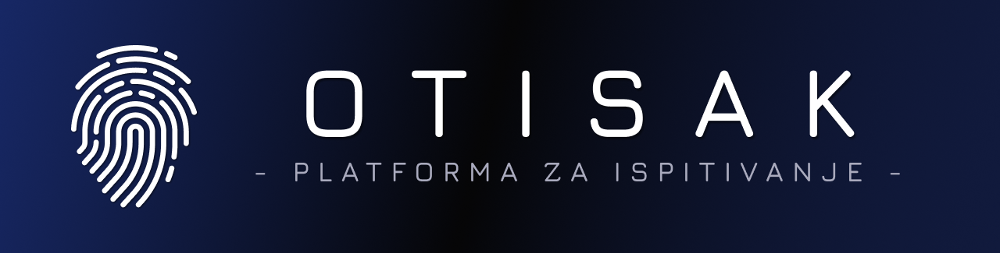

<p align="center">
  
</p>

<p align="center">
  <strong>Platforma za elektronsko polaganje ispita i kolokvijuma, koju institucija hostuje sama.</strong>
</p>

<p align="center">
  <a href="LICENSE"></a>
  <a href="https://github.com/MarkoGordic/otisak/commits/main"></a>
  
  
  
  
  
</p>

---

## O projektu

**OTISAK** je veb platforma za pripremu, sprovođenje i ocenjivanje ispita. Nastavnici sastavljaju testove i prate polaganje uživo. Studenti rade test u pregledaču, a rezultati su spremni odmah po predaji.

Sistem radi na sopstvenoj infrastrukturi institucije, bez spoljnih servisa, pa podaci o studentima i rezultatima ostaju kod vas.

## Mogućnosti

**Priprema ispita**
- Sedam tipova pitanja: jedan ili više tačnih odgovora, pitanja sa kodom, pitanja sa slikom, otvoreni odgovor, ređanje, povezivanje i dopunjavanje.
- Podešavanje trajanja, praga za prolaz, mešanja pitanja i odgovora, delimičnog bodovanja i negativnih poena.
- Banka pitanja po predmetu, sa oznakama i automatskim sastavljanjem testova.
- Uvoz i izvoz ispita, zajedno sa slikama, kao i masovni uvoz studenata iz CSV fajla.

**Sprovođenje ispita**
- Soba za praćenje uživo: napredak svakog studenta, zaključavanje ispita, produženje vremena i odobravanje kasnih dolazaka.
- Automatsko čuvanje odgovora, pa prekid veze ili osvežavanje stranice ne gube rad.
- Ugrađeni kalkulator i prikaz koda sa isticanjem sintakse.

**Ocenjivanje i izveštaji**
- Automatsko bodovanje zatvorenih pitanja i ručno ocenjivanje otvorenih odgovora.
- Statistika po ispitu i po pitanju.
- PDF izveštaj za svakog studenta i verzija testa za štampu.

**Za studente**
- Vežbe koje studenti pokreću sami, kad god žele, mimo zvaničnih termina.
- Pregled sopstvenih rezultata i istorije polaganja.

**Platforma**
- Interfejs na srpskom (latinica i ćirilica), bosanskom i engleskom jeziku, uz svetlu i tamnu temu.
- Prijava lokalnim nalogom, preko FreeIPA/LDAP direktorijuma ili preko ELPIS ID jedinstvene prijave.
- Uputstvo za korisnike dostupno u samoj aplikaciji.

## Uloge

| Uloga | Ovlašćenja |
|---|---|
| **Administrator** | Upravlja celim sistemom: korisnicima, predmetima, svim ispitima i pitanjima. |
| **Profesor / asistent** | Sastavlja i vodi ispite i ocenjuje odgovore na predmetima koji su mu dodeljeni. |
| **Student** | Polaže ispite na koje je prijavljen i radi javno dostupne vežbe. |

## Brzo pokretanje

Potrebni su vam [Docker](https://docs.docker.com/get-docker/) i Docker Compose.

```bash
git clone https://github.com/MarkoGordic/otisak.git
cd otisak
./deploy.sh
```

Skripta sama generiše tajne ključeve, podiže bazu i aplikaciju i na kraju ispisuje pristupne podatke za administratorski nalog. Aplikacija je zatim dostupna na `http://localhost:3000`.

Uz prvo pokretanje dolazi i primer vežbe, kako biste odmah videli kako sistem izgleda iz ugla studenta.

Detaljno uputstvo za postavljanje na server, podešavanje prijave i održavanje nalazi se u [DEPLOYMENT.md](DEPLOYMENT.md).

## Dokumentacija

- **Uputstvo za korisnike** je dostupno u aplikaciji na adresi `/docs`, na srpskom i engleskom jeziku. Izvorni tekstovi su u [`app/docs/`](app/docs/).
- **Postavljanje i održavanje:** [DEPLOYMENT.md](DEPLOYMENT.md).
- **Format za uvoz ispita:** [`app/docs/sr/json-format.md`](app/docs/sr/json-format.md).

## Licenca

Projekat je objavljen pod [MIT licencom](LICENSE).
